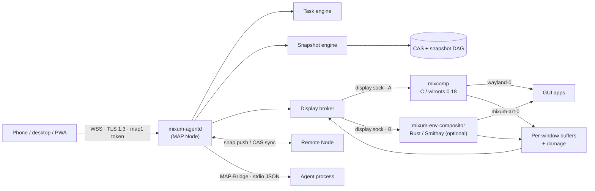

<div align="center">
  
  <h3>An early attempt at an agent OS that can rewind, fork, and move.</h3>
  <p>An Arch-based operating system for AI agents: containerized workspaces, git-like snapshot trees,<br/>native GUI windows streamed to any device, and state that travels between machines.</p>
  <p>
    <a href="https://github.com/EmergeShift/mixumOS/releases"></a>
    <a href="LICENSE"></a>
    <a href="https://www.rust-lang.org/"></a>
    <a href="https://archlinux.org/"></a>
    <a href="https://github.com/EmergeShift/mixumOS/actions/workflows/ci.yml"></a>
  </p>
  <p><a href="README.zh-CN.md">简体中文</a> · <strong>English</strong></p>
</div>

> **Status: v0.1.6, alpha.** This is an early build of an operating system, not a finished distro. Apple Silicon is the validated path; the x86_64 image is built and shipped for Docker but still needs hardware validation. Interfaces will move, docs are incomplete, and several pieces are still being filled in. The honest limitations are listed [below](#status-and-roadmap).

---

## Alpha, honestly

mixumOS is an alpha. It boots, snapshots, streams windows and moves state between
machines, but it is not a daily-driver OS yet: the console is early, CRIU is not
turnkey, the x86_64 image still needs validation, and some docs are ahead of the code.

We are a small, unfunded team. We would rather show the seams now than pretend
they are not there. If something breaks, open an issue with the command, the
version and the log; "it did not work" is still useful — we will ask for the rest.

The docs site is under construction at https://docs.emergeshift.com/mixumos.

## Why another operating system?

An agent that can only call tools is still a guest in someone else's process. Real work needs a **computer**: a workspace, a shell, applications, a desktop — and the ability to undo, inspect, and relocate all of it.

We kept running into the same gaps when we tried to let agents do real work in containers. The ones that mattered most to us:

- **Reversibility.** A bad `rm -rf`, a half-finished refactor, a broken package upgrade — there is no "go back".
- **A real desktop.** The agent opens a browser; you get a screenshot stream, not a window you can take over.
- **Mobility.** Your work is pinned to one machine. Closing the laptop means killing the task.
- **Portable memory.** What the agent learned dies with the container.

Our attempt is to treat the workspace as an **event-sourced filesystem**. Every task starts with a snapshot, every snapshot is a node in a tree, and the whole tree can be forked, restored, or pushed to another machine — while the agent's GUI keeps streaming as native windows.

## What it does today

| Capability | What it means in practice |
|---|---|
| **Snapshot tree, not a save button** | Content-addressed chunks + a DAG of nodes. Restore in place and keep working to create a parallel timeline; fork any past node into a named branch; nothing is ever deleted by rolling back. |
| **Hot pre-task snapshots** | A task snapshots its workspace *before* the agent runs. Measured median: **8.8 ms** for an unchanged 300-file workspace, **45 ms** for an unchanged 50 MiB file. |
| **Native window streaming** | Each GUI window is captured independently by `mixcomp`, or by the optional B compositor, and streamed over MAP. Attach a window, inject input, take over from the agent — or watch read-only. |
| **State that travels** | `snap.push` moves the tree peer-to-peer. The receiver reports missing chunks; re-pushing is **zero bytes**. A lid-close migration can resume a task in the cloud. |
| **GUI sessions that replay** | Snapshots record `guiSessions`; after a restore or a `.mart` migration, applications are relaunched with their windows. |
| **Agents as first-class citizens** | Rust `AgentDriver` SPI for embedded agents; the tiny line-delimited JSON **MAP-Bridge** for everything else. |
| **A real distribution** | `make dist` produces pacman packages, a pacman repository, rootfs and OCI images for `aarch64` and `x86_64` (0.1.6 ships both). Components upgrade independently with `pacman -S mixum-agentd`. |

### Rust at the core

The control plane and snapshot engine — the parts that parse untrusted protocol payloads and hold snapshot state — are Rust: `mixum-agentd`, the snapshot engine, the protocol crate, `mixum-ctl`, the gateway and the Kubernetes operator all live in one Cargo workspace. That buys memory safety at the snapshot/manifest boundary, a single async runtime (tokio), `rustls` for TLS 1.3, `ed25519-dalek` for capability tokens, `zstd` for chunk compression and `sled` for the tree index — with no GC pauses and no interpreter in the hot path.

C is used exactly where the ecosystem demands it: the Wayland compositor (`mixcomp`) is built directly on **wlroots 0.18**. TypeScript is used for the PWA console. No language is chosen for fashion; each boundary is explicit.

### Apple Container, first-class

macOS cannot run Linux containers natively. mixumOS supports **Apple Container** as a real backend, not a compatibility shim:

```bash
brew install container
container system start
```

- Ephemeral containers share the kernel, image blobs and APFS clonefile blocks. A full node (agentd + mixcomp) measured **≈38 MiB** of RAM; a second container from the same image added **0 MB** of physical disk.
- Warm container start measured **≈1.0 s** on an M1.
- A custom guest kernel, [`linux-mixum-micro`](kernel/README.md) (kata 6.18.35 base), enables CRIU, Landlock, FUSE, vsock/9p and the `-mixum-micro` fingerprint. Install it with `kernel/scripts/install-apple-container.sh` after reading the [kernel notes](docs/apple-container.md) — it is a **host-wide** setting and affects every Apple Container.

#### Switching the guest kernel, and switching back

Apple Container has one kernel setting for the whole host; there is no per-container kernel flag. Save the current kernel before installing mixumOS's:

```bash
# Save the current kernel before switching. The filename may differ; list $K first.
K="$HOME/Library/Application Support/com.apple.container/kernels"
cp "$K/vmlinux-6.18.35-197-debug" /tmp/vmlinux-original

# Switch to mixumOS's kernel (host-wide).
container system kernel set --binary /path/to/linux-mixum-micro-6.18.35-arm64.Image

# Switch back later.
container system kernel set --binary /tmp/vmlinux-original
```

New containers use the selected kernel; running containers keep the kernel they booted with until they are stopped and started. If the Apple Container service wedges after a switch, clean up the stuck VM and restart `container system`.

| Capability | Original kata kernel (no CRIU) | `linux-mixum-micro` |
|---|---|---|
| Disk snapshots, snapshot tree, fork, rollback | ✅ | ✅ |
| `.mart` cross-device migration (files) | ✅ | ✅ |
| `mixcomp` GUI stream / window replay | ✅ | ✅ |
| **Memory / hybrid snapshots (CRIU dump)** | ❌ | ✅ (aarch64 image bundles CRIU 4.1; custom images need it) |
| **Same-host process-level rollback (CRIU restore)** | ❌ | ✅ (aarch64 image bundles CRIU 4.1; custom images need it) |
| Landlock / FUSE / cgroup freezer / diag sockets | Depends on the original config | ✅ |

Reverting the kernel does **not** lose disk snapshots, `.mart` migration or window streaming. It loses the CRIU-based memory/hybrid capabilities until you switch back. Details and measured results: [docs/apple-container.md](docs/apple-container.md).

On Linux, the same node runs under Docker or directly on Arch. On Windows, the distro rootfs imports into WSL 2. See [backends](docs/backends.md) for the full matrix.

## Architecture



`mixcomp` (Route A) is bundled and is the compatibility baseline. Route B is
optional: MixumART supplies `mixum-env-compositor`, which runs inside the
container and connects to the same `/run/mixum/display.sock` broker. The broker
is the only component that speaks MAP over WSS to the host.

| Component | Language | Responsibility |
|---|---|---|
| `mixum-agentd` (installed as `mixumd`) | Rust | MAP Node: sessions, capability tokens, task engine, snapshot engine, display broker, cross-node sync |
| `mixum-snapshot` | Rust | Content-addressed store, manifests, snapshot tree DAG, CRIU, GC |
| `mixum-protocol` | Rust | Envelope, ops, tokens, binary frame headers |
| `mixum-ctl` | Rust | Host CLI: connect, tasks, snapshots, file transfer, window view, power hooks |
| `mixcomp` | C | Bundled Route A compositor; per-window capture and input injection on wlroots 0.18 |
| `mixum-env-compositor` (optional) | Rust | Route B Smithay compositor, supplied by MixumART; connects to the same display broker |
| `console/` | TypeScript | Installable PWA: tasks, window canvas, snapshot tree |
| `mixum-gateway` / `mixum-operator` | Rust | Cloud routing and Kubernetes operator (early) |
| `dist/` | Shell + PKGBUILD | Packages → pacman repo → rootfs/OCI images |

## Quick start

### Option A — let MixumART do the host work

[MixumART](https://github.com/EmergeShift/MixumART) is the desktop runtime manager for macOS, Windows and Linux. It creates and starts a mixumOS container for you, pins the TLS fingerprint, and opens a window per surface. This is the shortest path on a Mac with Apple Container.

### Option B — Docker/OCI from source

Requirements: Docker (or a Docker-compatible runtime), about 10 GB of free disk for the build, and `make`.

```bash
git clone https://github.com/EmergeShift/mixumOS.git
cd mixumOS

# Build packages + repository + rootfs + OCI for one architecture.
# The Makefile defaults to a colima context; override it for plain Docker:
DOCKER_CONTEXT=default make dist ARCH=aarch64

# Import the rootfs and start a Node.
docker import --platform linux/arm64 dist/out/rootfs-aarch64.tar mixumos:0.1.6-dev
docker run -d --name mixum-node \
  -p 127.0.0.1:17601:7601 \
  mixumos:0.1.6-dev /entrypoint.sh

# The first start prints a READY line containing a map1. bootstrap token.
docker logs mixum-node | grep READY
```

> The bootstrap token is an admin credential. Keep it out of shell history, screenshots and logs.

Drive the node with the host CLI:

```bash
cd rust
cargo build --release -p mixum-ctl

export MIXUM_ADDR=wss://127.0.0.1:17601/ws
export MIXUM_TOKEN='map1.…'   # from the READY line

./target/release/mixum-ctl task submit "inspect the workspace" \
  --agent shell --param cmd="ls -la"
./target/release/mixum-ctl snap tree
./target/release/mixum-ctl serve --bind 127.0.0.1:7602
# open http://127.0.0.1:7602/ for the local window viewer
```

`mixum-ctl` pins the node certificate on first connect (TOFU) in `~/.mixum/known-hosts`. The local viewer binds to loopback by default.

### Snapshot in 30 seconds

```bash
./target/release/mixum-ctl snap create --kind disk --label before-refactor
./target/release/mixum-ctl snap restore <node-id> --strategy inplace
./target/release/mixum-ctl snap fork <node-id> experiment
```

An in-place restore moves the branch head back; the next snapshot creates a **parallel timeline**, not a deletion. A fork points a new branch at any past node. This is the mental model:

```text
main:  genesis ── n1 ── n2 ── n3
                          │
                          └── restore(n2) + work ── n4   (parallel timeline)
```

## What we measured

All numbers below were measured on the reference machine and are reproducible from the repository. They are medians, not best cases; your hardware and cache state will differ.

| Metric | Result | How to reproduce |
|---|---|---|
| Pre-task snapshot, 300 × 2 KiB files, no changes | **8.8 ms** | `cargo run --release -p mixum-snapshot --example bench` |
| Pre-task snapshot, 50 MiB file, no changes | **45 ms** | same bench |
| Restore, 300 files / 50 MiB file | **689 ms** / **122 ms** | same bench |
| `mixumd` start → listening | **107 ms** cold / **102 ms** warm | `node tests/integration/startup-bench.mjs --runs 10` |
| `docker run` → connectable | **226 ms** median | same bench |
| Window stream | 30 fps, 54,361 frames over a 30-minute soak, zero disconnects | `tests/integration/soak-run.mjs` |
| Apple Container node memory | **≈38 MiB** for agentd + mixcomp | `container stats` (M1, 16 GB) |

The full methodology, including caveats about small-file workloads, is in [docs/snapshots.md §9](docs/snapshots.md).

## Security model

- **Transport:** WSS only, TLS 1.3, self-signed ECDSA P-256 certificate pinned by SHA-256 fingerprint (TOFU). A changed fingerprint is a hard disconnect.
- **Authorization:** `map1.` capability tokens signed with the node's ed25519 identity. Least privilege, optional bindings to a task, window list or memory provider. No ambient "logged-in user".
- **At rest:** CAS chunks are optionally encrypted with AES-256-GCM; the key is derived per store with HKDF-SHA256, and the AAD binds the store and plaintext chunk hash.
- **Inside the sandbox:** tasks run in their own process group; snapshots freeze with cgroup v2 freezer (falling back to `SIGSTOP`). Landlock confines writes to the workspace, `/tmp`, `/dev` and `/run` where the kernel supports it.
- **No telemetry.** The OS, the node and the CLI do not phone home. The only optional analytics live in the MixumART desktop app and are off by default.

Read the full [threat model](docs/security.md) and the ecosystem-wide [TRUST commitments](https://github.com/EmergeShift/Mixum-Agent-Protocol/blob/main/TRUST.md).

## Where we could be wrong

We are not sure the snapshot tree is the right abstraction for every agent
workflow, that CRIU can be made turnkey across kernels, or that streaming native
windows beats a browser-based desktop. We are also a small team, so parts of the
console and docs lag behind the engine.

If you have built sandboxes, snapshot systems or agent runtimes, we would like to
know where this design breaks — including "this is the wrong layer". Opening an
issue is enough; we will do the reading.

## Status and roadmap

| Area | State |
|---|---|
| Protocol, snapshot engine, agentd, `mixum-ctl` | ✅ Rust end-to-end; CI on Linux + Windows platform checks |
| Snapshot tree (restore / fork / GC / sync) | ✅ Double-node e2e, idempotent re-push |
| Display: per-window stream, input, takeover | ✅ 30 fps; png damage patches and H.264 negotiation |
| Apple Container + `linux-mixum-micro` | ✅ Verified on M1; CRIU/Landlock enabled in the guest kernel |
| Docker / OCI | ✅ aarch64 verified; ✅ x86_64 image built, Docker validation pending |
| WSL 2 | ✅ Rootfs import + systemd service; GUI streaming has known foot/WSL caveats |
| Distribution (`make dist`) | ✅ Dual-arch packages, repo, rootfs, OCI; v0.1.6 ships both archives |
| Console PWA | 🚧 Early; tasks, snapshots and window canvas work, polish pending |
| Gateway / Kubernetes operator | ✅ Gateway M1–M3; operator is early |
| Memory snapshots (CRIU) | ⚠️ Kernel support is there; the aarch64 image bundles patched CRIU 4.1, while x86_64 does not yet. Memory/hybrid remains pre-release |
| GPU / dmabuf zero-copy | ⏳ Waiting on stable virtio-gpu/venus paths; everything today is CPU `wl_shm` + damage |

**Known limitations, stated plainly:**

- v0.1.6 publishes **aarch64 and x86_64** images; x86_64 is built but Docker/hardware validation is still pending.
- Node-to-node `snap.push` uses TLS 1.3 but does not pin the peer certificate yet. Push only to nodes you trust or over a private network; client and gateway-relay connections do pin.
- Memory/hybrid snapshots are still pre-release; aarch64 bundles CRIU 4.1, x86_64 does not yet. Disk snapshots, migration and GUI replay do not depend on CRIU.
- Apple Container's kernel is a **host-wide** setting. Switching it affects every container on the machine; the [Apple Container guide](docs/apple-container.md) documents how to switch back and what you lose.
- The unikernel-style "one binary" story is explicitly not a goal; this is a distribution, with pacman doing dependency and security updates.

The staged plan lives in [docs/roadmap.md](docs/roadmap.md).

## Repository map

```text
mixumOS/
├── rust/                  Rust workspace: agentd, snapshot, protocol, ctl, gateway, operator
├── mixcomp/               C/wlroots 0.18 compositor
├── console/               PWA control surface
├── dist/                  PKGBUILDs, pacman repo tooling, rootfs/OCI assembly
├── kernel/                linux-mixum / linux-mixum-micro build + install scripts
├── tests/integration/     container e2e, soak, migration, gateway, audio, display
├── docs/                  architecture, protocol, snapshots, security, backends…
└── brand/                 logo and app icon sources
```

## Documentation

| Start here | What it answers |
|---|---|
| [Architecture](docs/architecture.md) | What the pieces are and why they are split this way |
| [Protocol v1](docs/protocol.md) | Envelope, ops, tokens, binary frames |
| [Snapshots](docs/snapshots.md) | CAS, tree semantics, CRIU, benchmarks |
| [Apple Container](docs/apple-container.md) | Kernel install, measured numbers, how to revert |
| [Host integration](docs/host-integration.md) | `mixum-ctl`, power hooks, local viewer, audio/IME |
| [Backends](docs/backends.md) | Docker, WSL 2, nvx, Kubernetes |
| [Security](docs/security.md) | Threat model and every defense |
| [Documentation map](DOCS.md) | Language, status and docs-first items for every page |
| [Migration](docs/migration.md) | `.mart` bundles and cross-device restore |
| [Distribution](docs/distro.md) | Packages, repo, image build and known pits |
| [Console](console/README.md) | PWA architecture and local dev |
| [Release notes 0.1.6](docs/release-notes-0.1.6.md) | What changed in the current release |
| [Roadmap](docs/roadmap.md) | Stages and exit criteria |

Most design documents are currently written in Chinese; this README and the MAP specification are the English entry points. Translation help is welcome and does not require code changes.

The wire contract is standardized as [MAP](https://github.com/EmergeShift/Mixum-Agent-Protocol); this repository is its reference **Node** implementation.

## Ecosystem

| Project | Role |
|---|---|
| **mixumOS** (this repo) | The OS distribution and reference MAP Node |
| [MixumART](https://github.com/EmergeShift/MixumART) | Desktop host: runtime management, CLI, MCP, native window rendering |
| [Mixum Agent Protocol](https://github.com/EmergeShift/Mixum-Agent-Protocol) | The open contract: spec, schemas, vectors, SDKs |

## Contributing

Issues and pull requests are welcome. The project is documentation-first: a behavioral change should update the relevant `docs/` page and a test that locks it. Before opening a PR:

```bash
cd rust
cargo fmt --all
cargo clippy --workspace --all-targets -- -D warnings
cargo test --workspace

cd ../console && npm ci && npm run build
```

Platform-specific work belongs in the backend crate, not in shared code. See the [architecture](docs/architecture.md) and [security](docs/security.md) docs before touching tokens or snapshot paths. For protocol semantics, the RFC process lives in the MAP repository.

## License

[Apache-2.0](LICENSE). The `kernel/` directory and the kernel binaries are **GPL-2.0** — see [`kernel/NOTICE`](kernel/NOTICE) and the [source offer](SOURCE_OFFER.md). `mixcomp` is an original compositor built on the unmodified wlroots 0.18.2 tarball; runtime libraries keep their own licenses (wlroots/wayland MIT, libxkbcommon MIT, json-c MIT, libjpeg-turbo IJG/BSD-3, zstd BSD). The Arch/ALARM base system inside the images keeps its upstream licenses.

---

<div align="center">
  <sub>Built with Rust, wlroots and Arch Linux, by a small team that really wants undo to work.</sub>
</div>
