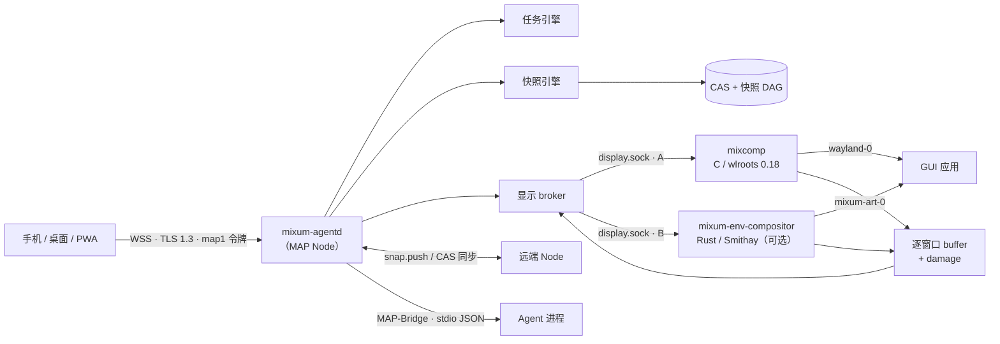

<div align="center">
  
  <h3>一个还在早期、尝试让 agent 能回退、分叉和迁移的操作系统。</h3>
  <p>基于 Arch Linux 的 AI agent 操作系统：容器化工作区、类 Git 的快照树、<br/>以原生窗口流到任意设备的 GUI，以及可在机器之间迁移的工作状态。</p>
  <p>
    <a href="https://github.com/EmergeShift/mixumOS/releases"></a>
    <a href="LICENSE"></a>
    <a href="https://www.rust-lang.org/"></a>
    <a href="https://archlinux.org/"></a>
    <a href="https://github.com/EmergeShift/mixumOS/actions/workflows/ci.yml"></a>
  </p>
  <p><strong>简体中文</strong> · <a href="README.md">English</a></p>
</div>

> **状态：v0.1.5，alpha。** 这是一个早期版本的操作系统，不是完成的发行版。本次验证的是 Apple Silicon；x86_64 构建路径存在，但未随 0.1.5 发布。接口会变，文档还不完整，很多地方仍在补。已知限制如实列在[下方](#状态与路线图)。

---

## 先说清楚：这是 alpha

mixumOS 是 alpha。它能启动、快照、串流窗口、在机器之间搬状态，但还不是一个能日常使用的操作系统：控制台还早，CRIU 不是开箱即用，x86_64 不在这次镜像里，部分文档跑在代码前面。

我们是一个没有融资的小团队。与其假装没有缝，不如现在就把缝露出来。遇到问题请开 issue，附上命令、版本和日志；“跑不起来”本身也有用，我们会再问细节。

文档站正在搭：https://docs.emergeshift.com/mixumos。

## 为什么还要一个操作系统？

只会调用工具的 agent，本质上仍是别人进程里的客人。真正干活需要一台**计算机**：工作区、shell、应用、桌面，以及把这一切撤销、检查、搬走的能力。

我们在让 agent 真正干活时，反复遇到同样的缺口。对我们最重要的几个：

- **可逆性。** 一条错误的 `rm -rf`、一次做到一半的重构、一个把系统搞坏的包升级——没有“退回去”这个选项。
- **真正的桌面。** agent 打开了浏览器，你拿到的是截图流，而不是一个可以接管的窗口。
- **迁移能力。** 工作被钉死在一台机器上；合上笔记本就等于杀掉任务。
- **可带走的记忆。** agent 学到的东西随容器一起消失。

我们的尝试是把工作区当成**事件溯源的文件系统**：每个任务开始前自动打快照，每个快照是树上的一个节点，整棵树可以 fork、回退，或推到另一台机器——与此同时，agent 的 GUI 一直以原生窗口流到你的设备。

## 目前能做什么

| 能力 | 实际意味着什么 |
|---|---|
| **快照树，不是保存按钮** | 内容寻址块 + 节点 DAG。原地回退后继续工作会自然长出一条并行时间线；任意历史节点都能 fork 成命名分支；回退永不删除未来。 |
| **无感前置快照** | 任务在 agent 启动*之前*先给工作区打点。实测中位数：未变更的 300 文件工作区 **8.8 ms**，未变更的 50 MiB 单文件 **45 ms**。 |
| **原生窗口流** | 每个 GUI 窗口由 `mixcomp`（或可选的 B 合成器）独立捕获并经 MAP 推流。可以 attach、注入输入、从 agent 手里接管，或只读观看。 |
| **状态可迁移** | `snap.push` 点对点搬整棵树；接收端只回报缺失块，重推**零字节**。合盖迁移可以把任务续到云端。 |
| **GUI 会话可重放** | 快照记录 `guiSessions`；restore 或 `.mart` 迁移后，应用会带着窗口重新拉起。 |
| **agent 是一等公民** | Rust `AgentDriver` SPI 供内嵌 agent 使用；其余 agent 走极小的行分隔 JSON **MAP-Bridge**。 |
| **真正的发行版** | `make dist` 产出 `aarch64` 与 `x86_64` 的 pacman 包、pacman 仓库、rootfs 和 OCI 镜像。单组件用 `pacman -S mixum-agentd` 独立升级。 |

### 核心是 Rust，边界很明确

控制面与快照引擎——解析不可信协议负载、持有快照状态的部分——用 Rust 写：`mixum-agentd`、快照引擎、协议 crate、`mixum-ctl`、gateway 和 Kubernetes operator 同处一个 Cargo workspace。换来的是快照/清单边界的 memory safety、单一异步运行时（tokio）、`rustls` 的 TLS 1.3、`ed25519-dalek` 的能力令牌、`zstd` 块压缩和 `sled` 树索引——热路径上没有 GC 停顿，也没有解释器。

C 只出现在生态强制要求的地方：Wayland 合成器 `mixcomp` 直接构建在 **wlroots 0.18** 上。TypeScript 用于 PWA 控制台。没有任何语言是为了时髦而选；每条边界都是显式的。

### Apple Container 是一等后端

macOS 不能原生跑 Linux 容器。mixumOS 把 **Apple Container** 当作真正的后端，而不是兼容层：

```bash
brew install container
container system start
```

- 临时容器共享内核、镜像 blob 与 APFS clonefile 块。完整节点（agentd + mixcomp）实测常驻 **≈38 MiB** 内存；同镜像再起一个容器，物理磁盘净增 **0 MB**。
- M1 上热启动实测 **≈1.0 s**。
- 自研 guest 内核 [`linux-mixum-micro`](kernel/README.md)（kata 6.18.35 基底）开启 CRIU、Landlock、FUSE、vsock/9p，并带 `-mixum-micro` 指纹。阅读 [内核说明](docs/apple-container.md) 后，用 `kernel/scripts/install-apple-container.sh` 安装——它是**宿主级全局设置**，会影响机器上每一个 Apple Container。

#### 切换 guest 内核，以及切回去

Apple Container 的内核是整台宿主一份设置，没有按容器指定的开关。安装 mixumOS 内核前先备份当前内核：

```bash
# 切换前先备份当前内核。文件名可能不同，先 ls $K 确认。
K="$HOME/Library/Application Support/com.apple.container/kernels"
cp "$K/vmlinux-6.18.35-197-debug" /tmp/vmlinux-original

# 切到 mixumOS 内核（宿主级）。
container system kernel set --binary /path/to/linux-mixum-micro-6.18.35-arm64.Image

# 以后切回去。
container system kernel set --binary /tmp/vmlinux-original
```

新建容器使用所选内核；已运行容器保持启动时的内核，直到 stop/start 才切换。切换后 Apple Container 服务若卡住，先清理卡住的 VM 再重启 `container system`。

| 能力 | 原 kata 内核（无 CRIU） | `linux-mixum-micro` |
|---|---|---|
| 磁盘快照、快照树、fork、回退 | ✅ | ✅ |
| `.mart` 跨设备迁移（文件层） | ✅ | ✅ |
| `mixcomp` GUI 流 / 窗口重放 | ✅ | ✅ |
| **memory / hybrid 快照（CRIU dump）** | ❌ | ✅（需容器内安装 `criu`） |
| **同机进程级回退（CRIU restore）** | ❌ | ✅（需容器内安装 `criu`） |
| Landlock / FUSE / cgroup freezer / diag socket | 取决于原内核配置 | ✅ |

切回原内核**不会**丢失磁盘快照、`.mart` 迁移或窗口流；丢的是基于 CRIU 的 memory/hybrid 能力，切回 `linux-mixum-micro` 后恢复。细节与实测见 [docs/apple-container.md](docs/apple-container.md)。

Linux 上同一个节点可以跑在 Docker，或直接跑在 Arch 上；Windows 上发行版 rootfs 可直接导入 WSL 2。完整矩阵见 [backends](docs/backends.zh-CN.md)。

## 架构



`mixcomp`（Route A）是内置的兼容基线。Route B 是可选的：MixumART 提供
`mixum-env-compositor`，在容器内运行，连接同一个 `/run/mixum/display.sock`
broker。只有 broker 通过 MAP over WSS 连到宿主。

| 组件 | 语言 | 职责 |
|---|---|---|
| `mixum-agentd`（安装为 `mixumd`） | Rust | MAP Node：会话、能力令牌、任务引擎、快照引擎、显示 broker、跨节点同步 |
| `mixum-snapshot` | Rust | 内容寻址存储、清单、快照树 DAG、CRIU、GC |
| `mixum-protocol` | Rust | Envelope、ops、令牌、二进制帧头 |
| `mixum-ctl` | Rust | 主机 CLI：连接、任务、快照、文件传输、窗口视图、电力钩子 |
| `mixcomp` | C | 内置 Route A 合成器；wlroots 0.18 上的逐窗口捕获与输入注入 |
| `mixum-env-compositor`（可选） | Rust | Route B Smithay 合成器，由 MixumART 提供；连接同一个显示 broker |
| `console/` | TypeScript | 可安装 PWA：任务、窗口画布、快照树 |
| `mixum-gateway` / `mixum-operator` | Rust | 云端路由与 Kubernetes operator（早期） |
| `dist/` | Shell + PKGBUILD | 包 → pacman 仓库 → rootfs/OCI 镜像 |

## 快速开始

### 路线 A — 让 MixumART 接管宿主侧

[MixumART](https://github.com/EmergeShift/MixumART) 是面向 macOS、Windows、Linux 的桌面运行时管理器。它会替你创建并启动 mixumOS 容器、固定 TLS 指纹，并为每个 surface 打开一个窗口。在 Mac 上配合 Apple Container，这是最短路径。

### 路线 B — 从源码构建 Docker/OCI

前置：Docker（或兼容运行时）、约 10 GB 空闲磁盘、`make`。

```bash
git clone https://github.com/EmergeShift/mixumOS.git
cd mixumOS

# 构建单架构的包 + 仓库 + rootfs + OCI。
# Makefile 默认使用 colima context；普通 Docker 请覆盖：
DOCKER_CONTEXT=default make dist ARCH=aarch64

# 导入 rootfs 并启动节点。
docker import --platform linux/arm64 dist/out/rootfs-aarch64.tar mixumos:0.1.5-dev
docker run -d --name mixum-node \
  -p 127.0.0.1:17601:7601 \
  mixumos:0.1.5-dev /entrypoint.sh

# 首次启动会打印带 map1. bootstrap 令牌的 READY 行。
docker logs mixum-node | grep READY
```

> bootstrap 令牌是 admin 凭据。不要让它进入 shell history、截图或日志。

用主机侧 CLI 驱动节点：

```bash
cd rust
cargo build --release -p mixum-ctl

export MIXUM_ADDR=wss://127.0.0.1:17601/ws
export MIXUM_TOKEN='map1.…'   # 来自 READY 行

./target/release/mixum-ctl task submit "检查工作区" \
  --agent shell --param cmd="ls -la"
./target/release/mixum-ctl snap tree
./target/release/mixum-ctl serve --bind 127.0.0.1:7602
# 打开 http://127.0.0.1:7602/ 使用本地窗口查看器
```

`mixum-ctl` 首次连接会把节点证书固定到 `~/.mixum/known-hosts`（TOFU）。本地查看器默认只监听回环地址。

### 30 秒理解快照

```bash
./target/release/mixum-ctl snap create --kind disk --label before-refactor
./target/release/mixum-ctl snap restore <node-id> --strategy inplace
./target/release/mixum-ctl snap fork <node-id> experiment
```

原地 restore 把分支 head 移回去；下一次快照会长出一条**并行时间线**，而不是删除旧未来。fork 则把任意历史节点指成一个新分支。心智模型如下：

```text
main:  genesis ── n1 ── n2 ── n3
                          │
                          └── restore(n2) 后继续工作 ── n4   （并行时间线）
```

## 我们实际测到的数字

以下数字都测自参考机器，且可用仓库内脚本复现。它们是中位数而不是最好成绩；你的硬件和缓存状态会带来差异。

| 指标 | 结果 | 复现方式 |
|---|---|---|
| 前置快照，300 个 2 KiB 文件，无变更 | **8.8 ms** | `cargo run --release -p mixum-snapshot --example bench` |
| 前置快照，50 MiB 单文件，无变更 | **45 ms** | 同上 |
| 恢复，300 文件 / 50 MiB 单文件 | **689 ms** / **122 ms** | 同上 |
| `mixumd` 启动 → 可监听 | 冷 **107 ms** / 热 **102 ms** | `node tests/integration/startup-bench.mjs --runs 10` |
| `docker run` → 可连接 | 中位 **226 ms** | 同上 |
| 窗口流 | 30 fps，30 分钟浸泡 54,361 帧，零断连 | `tests/integration/soak-run.mjs` |
| Apple Container 节点内存 | agentd + mixcomp **≈38 MiB** | `container stats`（M1，16 GB） |

完整口径（包括小文件工作区的短板）见 [docs/snapshots.md §9](docs/snapshots.md#9-rust-实现记录)。

## 安全模型

- **传输：** 仅 WSS、TLS 1.3、自签 ECDSA P-256 证书，按 SHA-256 指纹固定（TOFU）。指纹变化即硬断连。
- **授权：** `map1.` 能力令牌由节点 ed25519 身份签名。最小权限，可进一步绑定到某个任务、窗口列表或 memory provider。不存在“已登录用户”这种环境权限。
- **静态数据：** CAS 块可选 AES-256-GCM 加密；密钥按 store 用 HKDF-SHA256 派生，AAD 绑定 store 与明文块哈希。
- **沙箱内：** 任务在独立进程组中运行；快照优先用 cgroup v2 freezer 冻结（不可用时退回 `SIGSTOP`）。内核支持时用 Landlock 把写入限制在工作区、`/tmp`、`/dev` 和 `/run`。
- **无遥测。** OS、节点和 CLI 都不回传数据。唯一可选的统计在 MixumART 桌面端，且默认关闭。

完整[威胁模型](docs/security.zh-CN.md)与生态级 [TRUST 承诺](https://github.com/EmergeShift/Mixum-Agent-Protocol/blob/main/TRUST.md)。

## 我们可能错在哪

我们不确定快照树是不是所有 agent 工作流都合适的抽象，不确定 CRIU 能不能做到跨内核开箱即用，也不确定“原生窗口流”一定比浏览器桌面更好。我们还是一个很小的团队，控制台和文档有时会落后于引擎。

如果你做过沙箱、快照系统或 agent 运行时，欢迎直接告诉我们这套设计哪里会坏——包括“这层就选错了”。开个 issue 就行，读资料的事我们来。

## 状态与路线图

| 领域 | 状态 |
|---|---|
| 协议、快照引擎、agentd、`mixum-ctl` | ✅ Rust 全链；CI 覆盖 Linux + Windows 平台边界 |
| 快照树（回退 / fork / GC / 同步） | ✅ 双节点 e2e，幂等重推 |
| 显示：逐窗口流、输入、接管 | ✅ 30 fps；PNG 损伤补丁与 H.264 协商 |
| Apple Container + `linux-mixum-micro` | ✅ M1 验证；guest 内核开启 CRIU/Landlock |
| Docker / OCI | ✅ 验证通过；x86_64 走 qemu-user 构建 |
| WSL 2 | ✅ rootfs 导入 + systemd 服务；GUI 流有已知 foot/WSL 问题 |
| 发行版（`make dist`） | ✅ 双架构包、仓库、rootfs、OCI；v0.1.5 发布 aarch64 资产 |
| PWA 控制台 | 🚧 早期；任务、快照、窗口画布可用，细节待打磨 |
| Gateway / Kubernetes operator | ✅ Gateway M1–M3；operator 处于早期 |
| 内存快照（CRIU） | ⚠️ 内核能力已开，但镜像**未内置** `criu`。Arch 的 CRIU 4.2.1 在此内核上会崩；PoC 使用 Debian CRIU 3.17.1 |
| GPU / dmabuf 零拷贝 | ⏳ 等待稳定的 virtio-gpu/venus 通路；当前全部是 CPU `wl_shm` + damage |

**如实说明的已知限制：**

- v0.1.5 只发布 **aarch64** 镜像；x86_64 构建通路已验证，但不在本次发布资产中。
- 在 CRIU 打包问题解决前，memory/hybrid 快照还不是开箱即用。磁盘快照、迁移和 GUI 重放不依赖 CRIU。
- Apple Container 的内核是**宿主级**设置，切换会影响机器上所有容器；[Apple Container 指南](docs/apple-container.md)写明了如何切回以及会失去什么。
- 项目明确不追求“单一静态二进制”的 unikernel 叙事；这是一个发行版，依赖与安全更新交给 pacman。

分阶段计划见 [docs/roadmap.md](docs/roadmap.md)。

## 仓库地图

```text
mixumOS/
├── rust/                  Rust workspace：agentd、snapshot、protocol、ctl、gateway、operator
├── mixcomp/               C/wlroots 0.18 合成器
├── console/               PWA 控制面
├── dist/                  PKGBUILD、pacman 仓库工具、rootfs/OCI 组装
├── kernel/                linux-mixum / linux-mixum-micro 构建与安装脚本
├── tests/integration/     容器 e2e、浸泡、迁移、gateway、音频、显示
├── docs/                  架构、协议、快照、安全、后端……
└── brand/                 logo 与 app icon 源文件
```

## 文档地图

| 从这里开始 | 回答什么问题 |
|---|---|
| [架构](docs/architecture.zh-CN.md) | 有哪些部件，为什么这样拆 |
| [协议 v1](docs/protocol.md) | Envelope、ops、令牌、二进制帧 |
| [快照](docs/snapshots.md) | CAS、树语义、CRIU、基准 |
| [Apple Container](docs/apple-container.md) | 内核安装、实测数字、如何切回 |
| [主机集成](docs/host-integration.md) | `mixum-ctl`、电力钩子、本地查看器、音频/输入法 |
| [后端形态](docs/backends.zh-CN.md) | Docker、WSL 2、nvx、Kubernetes |
| [安全](docs/security.zh-CN.md) | 威胁模型与每一条防线 |
| [迁移](docs/migration.zh-CN.md) | `.mart` 包与跨设备恢复 |
| [发行版构建](docs/distro.md) | 包、仓库、镜像构建与踩坑 |
| [控制台](console/README.md) | PWA 架构与本地开发 |
| [0.1.5 发布说明](docs/release-notes-0.1.5.md) | 当前版本改了什么 |
| [路线图](docs/roadmap.md) | 阶段与完成标准 |

设计文档目前以中文为主；英文入口是这份 README 与 MAP 规范。欢迎帮忙翻译，不需要改代码。

线协议已经标准化为 [MAP](https://github.com/EmergeShift/Mixum-Agent-Protocol)；本仓库是它的参考 **Node** 实现。

## 生态

| 项目 | 角色 |
|---|---|
| **mixumOS**（本仓库） | OS 发行版与参考 MAP Node |
| [MixumART](https://github.com/EmergeShift/MixumART) | 桌面宿主：运行时管理、CLI、MCP、原生窗口渲染 |
| [Mixum Agent Protocol](https://github.com/EmergeShift/Mixum-Agent-Protocol) | 开放契约：规范、schema、向量、SDK |

## 参与贡献

欢迎 issue 和 PR。项目是文档先行：行为变更应同步修改对应的 `docs/` 页面，并补一个锁住该行为的测试。开 PR 之前：

```bash
cd rust
cargo fmt --all
cargo clippy --workspace --all-targets -- -D warnings
cargo test --workspace

cd ../console && npm ci && npm run build
```

平台相关工作应落在后端 crate，而不是共享代码。改令牌或快照路径之前，请先读[架构](docs/architecture.zh-CN.md)和[安全](docs/security.zh-CN.md)。协议语义的 RFC 流程在 MAP 仓库。

## 许可证

[Apache-2.0](LICENSE)。`kernel/` 目录与内核二进制是 **GPL-2.0**——见 [`kernel/NOTICE`](kernel/NOTICE) 和[源码提供说明](SOURCE_OFFER.md)。`mixcomp` 是基于未修改的 wlroots 0.18.2 tarball 自研的合成器；运行时库遵循各自许可（wlroots/wayland MIT、libxkbcommon MIT、json-c MIT、libjpeg-turbo IJG/BSD-3、zstd BSD）。镜像内的 Arch/ALARM 基础系统遵循上游许可。

---

<div align="center">
  <sub>用 Rust、wlroots、Arch Linux，以及对“撤销”这件事的充分尊重构建。</sub>
</div>
