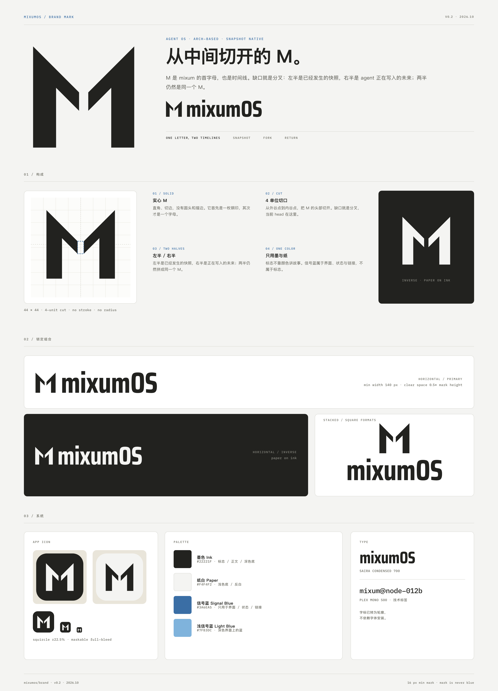

# mixumOS 品牌标记

> v0.2 · 2026.10 · 资产位于 `mixumos/brand/`

## 一句话

**M 被从中间切开。缺口就是分叉。**

M 是 mixum 的首字母，也是一条时间线：

- **实心 M**：直角、切边，没有描边和圆头。它首先是一枚钢印，其次才是一个字母。
- **4 单位切口**：从外谷点到内谷点，把 M 的头部切开。这是当前 head，也是下一次 fork / 回退的位置。
- **左半 / 右半**：左半是已经发生的快照，右半是 agent 正在写入的未来；两半仍然拼成同一个 M。
- **单色**：标志只用墨与纸。信号蓝属于界面、状态和链接，不属于标志。

这一版参考的是 Arch / Debian / Red Hat / CentOS 的共同点：一个**实心、单色、能缩到 16 px** 的轮廓，而不是一个带两色分割或渐变的科技图标。

## 标志

| 项 | 值 |
|---|---|
| 视觉尺寸 | 44 × 44（画布 64） |
| 左半 | `M10 52 V8 L30 28 V36 L20 26 V52 Z` |
| 右半 | `M34 28 L54 8 V52 H44 V26 L34 36 Z` |
| 切口 | `x 30–34`，`y 28–36`，4 × 8 单位 |
| 描边 / 圆角 | 无 |

缩到 16 px 时，切口收成一条发丝线，它首先是一个加粗的 M；放大后才看见分叉。

## 字标

`mixumOS` 用 **Saira Condensed 700**，字距 -0.012 em，`mixum` 与 `OS` 之间额外 0.01 em。字标已全部转为轮廓，不依赖字体安装。

为什么是 Saira Condensed：窄、方、笔画收口硬，和实心 M 的工程感一致；Plex Sans 那种圆润的默认字形会把它拉回 SaaS 图标。

字标全墨。信号蓝只在界面里出现；不要把 `OS` 单独上蓝，也不要改字标的字重或字距。

## 颜色

| Token | Hex | 用法 |
|---|---|---|
| 墨色 Ink | `#22221F` | 标志、正文、深色底 |
| 纸白 Paper | `#F4F4F2` | 浅色底、反白 |
| 信号蓝 Signal Blue | `#3A6EA5` | 界面、状态、链接；**不用于标志** |
| 浅信号蓝 Light Blue | `#7FB3DC` | 深色界面上的蓝 |

对比度：墨 / 纸 **14.5:1**；蓝 / 纸 **4.8:1**；浅蓝 / 墨 **7.1:1**。**不要**把 `#3A6EA5` 放在 `#22221F` 上（3.0:1）。

## 尺寸与清空区

- 标志：数字 16 px / 印刷 6 mm 起。
- 横排锁定：数字 140 px 宽 / 印刷 30 mm 起。
- 竖排锁定：数字 100 px 宽 / 印刷 25 mm 起。
- 清空区：标志四周 ≥ 0.5 × 标志高度；锁定组合四周 ≥ 0.5 × 字标 cap height。
- 低于最小尺寸时，只用标志，不用锁定组合。

## 用法

**用**

- 浅色底用 `logo-*.svg`，深色底用 `logo-*-inverse.svg`。
- 单色印刷、烫金、刻字用 `logo-*-mono.svg`（`currentColor`）。
- 应用启动器 / 桌面用 `app-icon.svg`；圆形遮罩 / 自适应图标用 `app-icon-maskable.svg`。
- 需要方形构图时用竖排锁定。

**不要**

- 不要改变左右两半的比例，不要把切口合上或改成装饰线。
- 不要给标志上色，不要把蓝色放进标志。
- 不要加阴影、描边、斜面、3D、发光或渐变。
- 不要旋转、拉伸、倾斜；不要自行改字距或换字体。
- 不要把深色底的蓝换成 `#3A6EA5`（用 `#7FB3DC`）。

## 文件

| 文件 | 内容 |
|---|---|
| `logo-mark.svg` | 标志，浅色底，透明背景，52 × 52 |
| `logo-mark-inverse.svg` | 标志，深色底 |
| `logo-mark-mono.svg` | 单色（`currentColor`） |
| `logo-wordmark.svg` | 字标全墨，331 × 75 |
| `logo-wordmark-inverse.svg` | 字标反白 |
| `logo-wordmark-mono.svg` | 字标单色 |
| `logo-lockup-horizontal.svg` | 横排锁定全墨，418 × 75 |
| `logo-lockup-horizontal-inverse.svg` | 横排反白 |
| `logo-lockup-horizontal-mono.svg` | 横排单色 |
| `logo-lockup-stacked.svg` | 竖排锁定，331 × 196 |
| `logo-lockup-stacked-inverse.svg` / `-mono.svg` | 竖排反白 / 单色 |
| `app-icon.svg` | 1024 圆角方，墨底纸 M |
| `app-icon-paper.svg` | 1024 圆角方，纸底墨 M |
| `app-icon-maskable.svg` | 1024 满幅，自适应图标安全区 |
| `brand-sheet.png` | 品牌页 |
| `preview.png` | 发行版语境预览（boot / 终端 / 贴纸） |
| `png/` | 常用 PNG 导出 |

## 修改

标志是两条实心路径：直接改 `logo-mark.svg` 里的两条 `path`，再同步 `-inverse` / `-mono` 和锁定组合。切口的位置和宽度由左右两条路径的 `x 30/34`、`y 28/36` 决定。

字标是轮廓。改字需要重新从 Saira Condensed 700 生成；`mixum` 与 `OS` 分属两条 path，目前同为墨色；不要把 `OS` 单独上蓝。

## 后续（裸金属）

这个标记按“能缩到 16 px、能单色、能做启动画面”设计：

- **Plymouth / systemd-boot / GRUB**：深色底 + `logo-mark-inverse`，字标在下方，版本号用 Plex Mono。
- **安装器**：左上角横排锁定，主按钮用信号蓝。
- **终端登录 banner**：标志的 ASCII 版本 + `mixumOS 0.1.x`。
- **包管理器 / 桌面图标**：`app-icon.svg`。

现有 console 的 PWA 图标仍是占位；要替换时，用 `png/app-icon-*.png` 覆盖 `console/public/icons/`，本次没有改动代码。

## 字体

字标基于 **Saira Condensed 700**（SIL OFL 1.1）转为轮廓；技术标签用 IBM Plex Mono 500（SIL OFL 1.1）。本目录不包含字体文件。
